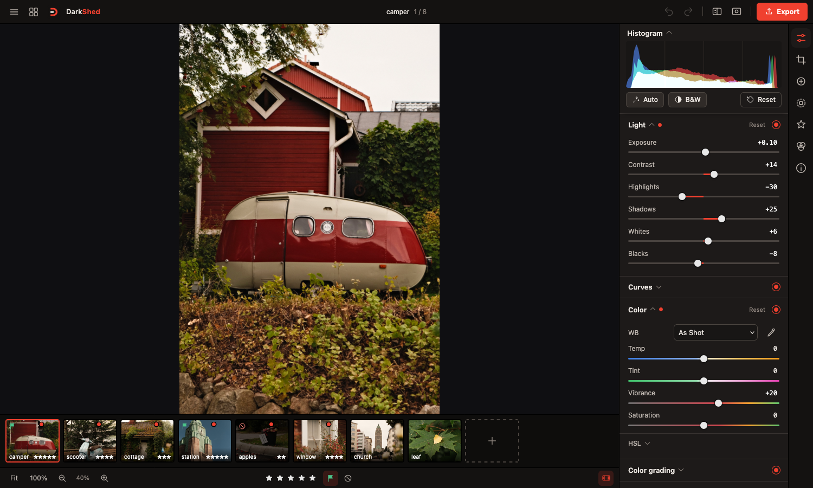
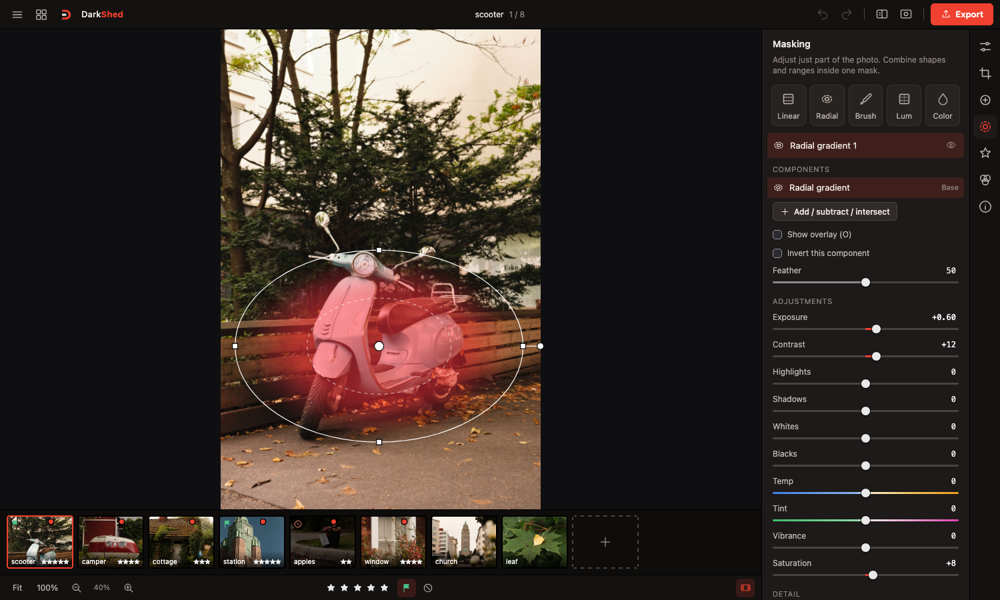
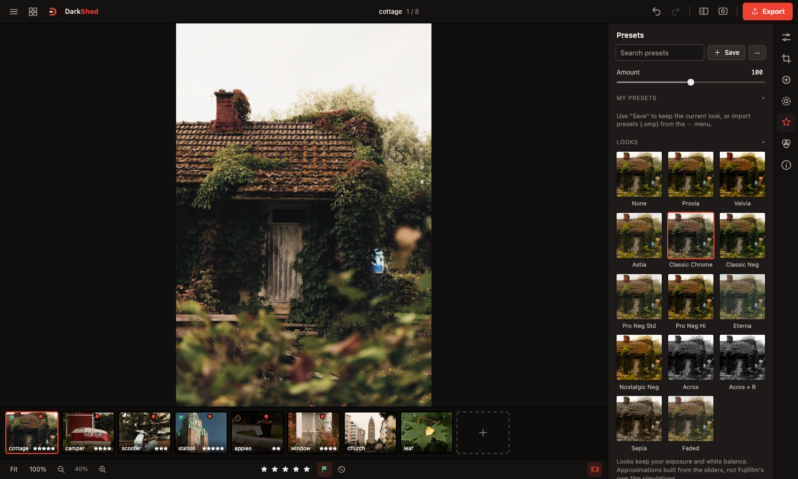
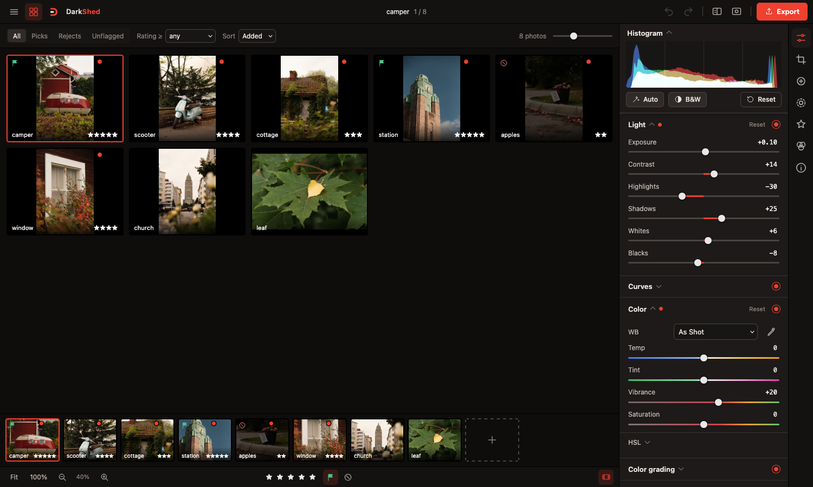
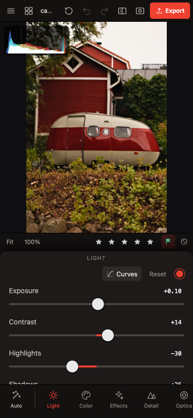
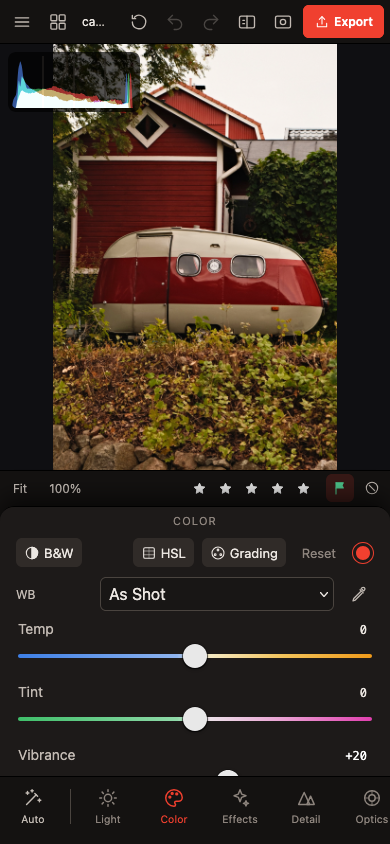
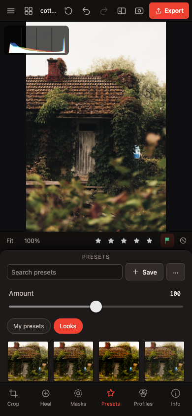
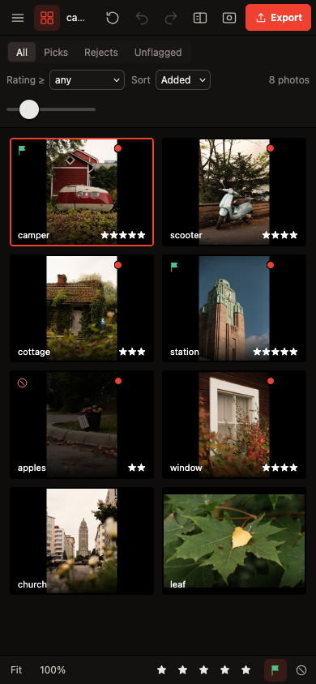

# DarkShed


*A darkroom, but in a shed.*

A free, Lightroom-style **RAW + JPEG photo editor** that runs in your browser on Mac, iPad and iPhone. You host it yourself, on a home server or any machine that runs Docker.

- **Private:** editing happens on your own device (decoding with LibRaw/WebAssembly, rendering on the GPU). Photos are never uploaded, not even to your server.
- **Synced presets:** your presets and LUTs sync between all your devices through your own server.
- **Made for RAW:** Fujifilm RAF, DNG, CR2/3, NEF, ARW and more, plus JPEG, PNG and HEIC. Imports and exports Lightroom presets.

*Why it exists:* Lightroom costs money, and the other vibe-coded "Lightroom killers" were desktop-only or tied to specific hardware. DarkShed is one web app that works on whatever you own.

> **Status: beta (0.9).** Tested on desktop browsers and on an iPhone 16 Pro. Expect rough edges.

---

## Screenshots

<table>
  <tr>
    <td width="50%"><br><sub><b>Edit.</b> Sliders, histogram and filmstrip.</sub></td>
    <td width="50%"><br><sub><b>Masks.</b> Radial, linear, brush and range masks.</sub></td>
  </tr>
  <tr>
    <td width="50%"><br><sub><b>Presets.</b> Built-in looks, imported presets and LUTs, previewed on your photo.</sub></td>
    <td width="50%"><br><sub><b>Grid.</b> Culling with ratings and flags.</sub></td>
  </tr>
</table>

The same app on a phone, with a layout built for touch:

<table>
  <tr>
    <td width="25%"><br><sub><b>Edit</b></sub></td>
    <td width="25%"><br><sub><b>Color</b></sub></td>
    <td width="25%"><br><sub><b>Presets</b></sub></td>
    <td width="25%"><br><sub><b>Grid</b></sub></td>
  </tr>
</table>

*Photos by [Hert Niks](https://www.pexels.com/@hert/) on Pexels.*

---

## What it does

- **Edit:** Light, Curves, Color (white balance with presets, HSL, color grading), Effects (texture, clarity, dehaze, vignette, grain), Detail (sharpening, noise reduction), Optics (color fringing, distortion), Calibration, B&W and LUTs.
- **RAW profiles:** a Profiles tab (RAW files only) with a preview of each: Standard, Camera Matching (copies the look of the JPEG your camera stored in the file, so it works for any camera), Neutral, Vivid, Landscape and Portrait. RAW photos get a base tone curve fitted to common cameras, so they open with contrast instead of flat.
- **Local tools:** crop and straighten, spot removal (heal and clone), masks (linear, radial, brush, luminance and color range, with add, subtract and intersect).
- **Library:** multiple photos with a filmstrip and a grid for culling (ratings, flags, filters).
- **Presets:** search, save your own, import `.xmp`, `.lrtemplate` and `.zip` packs and `.cube` LUTs, export as `.xmp`. An Amount slider fades a preset in and out, tapping an applied preset again removes it, and presets replace each other instead of stacking. A few Fujifilm-inspired **Looks** are built in; they keep your exposure and white balance.
- **Export:** JPEG, PNG, WebP or 16-bit TIFF, with resize, output sharpening, sRGB or Display P3, and batch export as a ZIP.
- **Safety net:** undo and redo, autosave, and copies of your open photos kept on the device so work survives an app reload. Stored copies clean themselves up (7 days unused, 1 GB cap by default; changeable in Settings).

The Fujifilm-style looks are approximations built from the sliders, not Fujifilm's own film simulations. RAW rendering and the sliders are tuned to resemble Lightroom, but they are not an exact match.

## Install

### With Docker (recommended)

You need a machine with [Docker](https://docs.docker.com/engine/install/) and the Compose plugin.

**1. Download the compose file**

```bash
mkdir darkshed && cd darkshed
curl -O https://raw.githubusercontent.com/hertn/darkshed/main/docker-compose.yml
```

**2. Start it**

```bash
docker compose up -d
```

**3. Open it**

Go to `http://<your-server-ip>:8080` in a browser.

That's it. Your presets are saved in the `data` folder next to the compose file.

**Things you might need to change in `docker-compose.yml`:**

| What | How |
|---|---|
| Port 8080 is already used | Change the left number in `ports: ["8080:8080"]`, for example `"8082:8080"` |
| Require a password for syncing | Set `DARKSHED_TOKEN` to any secret, then enter it in **Menu → Sync & settings** |
| Fedora / RHEL (SELinux) | Already handled (`:z` on the data folder) |
| Automatic updates | Already included: the bundled Watchtower checks hourly. Delete the `watchtower` block if you already run Watchtower or prefer to update by hand |

**Update by hand:** `docker compose pull && docker compose up -d`

### Without Docker

Needs Node.js 20 or newer.

```bash
npm install
npm run build
npm start        # http://localhost:8080
```

Environment variables: `DARKSHED_PORT` (default 8080), `DARKSHED_DATA` (default `./data`), `DARKSHED_TOKEN` (optional sync password).

## Use it on iPhone and iPad

1. Open the address in **Safari**.
2. Tap **Share → Add to Home Screen**.
3. Open DarkShed from the new icon. It runs full-screen like an app.

Good to know:

- **Add to Home Screen works over plain `http://`** on a home network. For access from outside your home, put it behind HTTPS (for example `tailscale serve --bg 8080`, a Cloudflare tunnel, or a reverse proxy like Caddy). HTTPS is also needed for offline use.
- JPEG exports keep their full size on iPhone and iPad (DarkShed encodes them itself). PNG and WebP exports are limited to about 16 megapixels there (a Safari limit), and 16-bit TIFF is desktop only.
- Open RAW files through the **Files** picker. The Photos picker may hand over a converted JPEG.

## Syncing presets

Sync is automatic when you open the app **from your own DarkShed server**, and optional: everything also works on a single device without it. There is nothing to set up. Leave **Server URL** empty, and enter a **Token** only if you started the server with `DARKSHED_TOKEN`.

- **Use the same address on every device.** Presets sync through the server you opened the app from. A test copy (for example `localhost:5173` from `npm run dev`) or a different address is a separate app with its own presets and does not sync.
- **When it syncs:** when the app opens, a moment after you change a preset, and when you switch back to the app. A preset added on one device shows up on another the next time that device opens the app or comes back to it.
- **Check it:** **Menu → Sync & settings** shows "Connected" or says why it is not syncing.
- Photos and per-photo edits are never sent to the server.

## Development

```bash
npm install
npm run dev      # http://localhost:5173, also reachable from your phone on the same Wi-Fi
```

Plain JavaScript with no framework. Image processing is WebGL2 shaders; the server (`server/index.mjs`) is one Node file with no dependencies and only stores presets and LUTs.

## Contributing

Forks, bug reports and pull requests are welcome. DarkShed is a hobby project made for personal use, so replies can be slow and I can't promise to merge everything or fix every issue. If you want something different, fork it and make it yours, the license allows that.

- **Found a bug or have an idea?** Open an [issue](https://github.com/hertn/darkshed/issues). A short description and your device (for example "iPhone 16 Pro, iOS 26") helps a lot.
- **Want to change the code?** Fork the repo, make your change, and open a pull request. `CLAUDE.md` has notes on how the project is laid out and how it is tested.

## License and credits

Directed by [Hert Niks](https://github.com/hertn). Built by [Claude](https://claude.com/claude-code) (Anthropic).

MIT, see `LICENSE`. RAW decoding uses [LibRaw](https://www.libraw.org/) (LGPL 2.1 / CDDL 1.0) through [libraw-wasm](https://github.com/ybouane/LibRaw-Wasm) (ISC). DarkShed is an independent project, not affiliated with or endorsed by Adobe or Fujifilm. Lightroom, Adobe and Fujifilm are trademarks of their owners.
